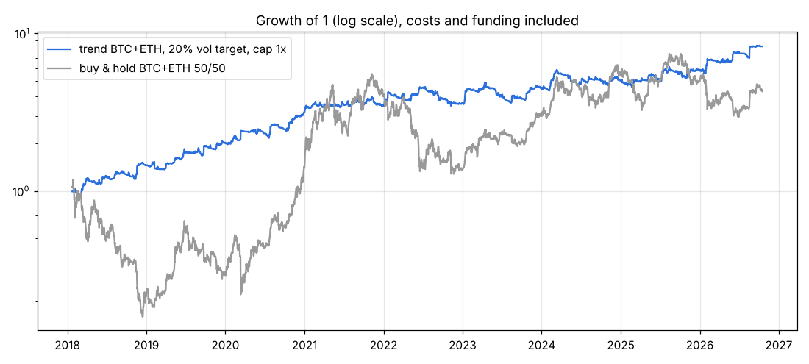

# Тренд BTC + ETH на дневках

Системная стратегия следования тренду на бессрочных фьючерсах (perpetual) BTCUSDT и ETHUSDT. Раз в сутки после закрытия дня
(00:00 UTC) считаются целевые позиции; между пересчётами ничего не делаем.

Это не «предсказание цены» и не микро-edge, а давно известная премия за следование тренду: крипта движется длинными трендами,
стратегия держит лонг на ростах и шорт на обвалах, а размер позиции подстраивает под волатильность.

## Правило (зафиксировано, параметры не подгонялись)

Для каждой монеты (BTC, ETH), по дневным ценам закрытия:

1. **Сигнал** = среднее из трёх знаков: `sign(цена − SMA20)`, `sign(цена − SMA50)`, `sign(цена − SMA100)`.
   Значения: +1 (все выше — лонг), +⅓, −⅓, −1 (все ниже — шорт).
2. **Размер по волатильности**: сигнал × min(2, 50% / волатильность за 20 дней, годовая).
3. **Портфель**: риск BTC и ETH выравнивается (по волатильности их собственных результатов за 60 дней), затем весь портфель
   масштабируется на **целевую волатильность** (по умолчанию 20% годовых) по волатильности за 60 дней.
4. **Ограничение плеча**: |позиция BTC| + |позиция ETH| ≤ CAP × капитал (по умолчанию 1×).
5. Позиция, посчитанная по закрытию дня D, держится в течение дня D+1.

Весь код правила — функция `target_positions` в `trend.py`; бэктест и живой сигнал используют её же.

## Как торговать

```bash
pip install -r requirements.txt
python signal_today.py --equity 10000              # раз в сутки, после 00:00 UTC (03:00 МСК)
python signal_today.py --equity 10000 --log forward.csv   # то же + запись в журнал для форвард-теста
```

Пример вывода (свеча от 17.10.2026, закрылась 18.10 00:00 UTC):
```
  BTCUSDT: +0.081 x equity (LONG)  = +806 USD
  ETHUSDT: -0.028 x equity (SHORT) = -284 USD
```
Дальше на бирже довести позиции по перпетуалам до этих размеров (докупить/продать разницу). Плечо в настройках биржи
ставить 3–5× — это только про маржу; реальный риск задаёт размер позиции из скрипта. Плюс = лонг, минус = шорт.

Режимы (`--vol` и `--cap`): 20% / 1× — консервативно (по умолчанию), 30% / 1.5×, 40% / 2×. Выше 40% не рекомендуется (см. «Риски»).

## Результаты бэктеста (публичные данные Binance, комиссия 0.10% на изменение позиции, фандинг учтён)

```bash
python backtest.py                       # 20% / 1x
python backtest.py --vol 0.40 --cap 2    # агрессивнее
```

Доходность за год, %:

| Год | 20% вол., плечо ≤1× | 30%, ≤1.5× | 40%, ≤2× | Купить и держать BTC+ETH |
|---|---|---|---|---|
| 2018 | +45.8 | +76.1 | +112.6 | −78.6 |
| 2019 | +39.0 | +63.8 | +93.1 | +38.2 |
| 2020 | +56.5 | +95.7 | +144.8 | +378.7 |
| 2021 | +11.0 | +16.9 | +23.1 | +182.4 |
| 2022 | +2.8 | +4.2 | +5.7 | −65.9 |
| 2023 | +24.0 | +38.1 | +53.8 | +120.8 |
| 2024 | +12.3 | +18.9 | +26.0 | +79.9 |
| 2025 | +16.4 | +25.5 | +35.4 | −8.7 |
| 2026 (до 17.10) | +41.2 | +67.9 | +99.5 | −13.3 |

| 2018-01 … 2026-10 | 20% / 1× | 30% / 1.5× | 40% / 2× | Купить и держать |
|---|---|---|---|---|
| Годовых (CAGR) | 27.4% | 43.7% | 62.2% | 18.2% |
| Волатильность | 22.6% | 34.0% | 45.3% | 71.3% |
| Sharpe | 1.07 | 1.07 | 1.07 | 0.23 |
| Макс. просадка | 25.8% | 36.1% | 44.9% | 86.6% |
| $1 → | 8.3 | 23.8 | 68.5 | 4.4 |
| Средняя позиция (доля капитала) | 0.3–0.4 | 0.4–0.65 | 0.5–0.9 | 1 |

Ещё (20% / 1×): плюсовых месяцев 56%, худший месяц −9%, лучший +26%, самый долгий период без нового максимума — 495 дней.
Издержки ≈ 3% в год, фандинг ≈ 2% в год (уже вычтены).

## Насколько этому можно верить

Подробно — `docs/VALIDATION.md`. Коротко:
* Правило (SMA50, 50%-вол) объявлено **до** первого запуска; на 2017–2019 (данные, которые до этого вообще не смотрели) оно дало
  Sharpe 1.28 (BTC) и 1.40 (ETH).
* Окна 20/50/100/200 дней — все положительны; час пересчёта (00/08/16 UTC) — Sharpe 0.6–1.1.
* Контроль «та же схема, но всегда в лонг»: Sharpe 0.21. Тот же сигнал, сдвинутый во времени (50 сдвигов): в среднем −0.11, максимум 0.52.
* Блочный бутстреп: 90%-й интервал Sharpe 0.55…1.58.
* Спецификация с ансамблем 20/50/100 и потолком плеча написана **после** этих проверок — сама по себе она не новое доказательство.

## Риски — прочитать до того, как торговать

1. **Честное ожидание Sharpe 0.5–1, а не 1.07.** 9 лет — это 4–5 больших трендовых циклов. При Sharpe 0.7 реалистично:
   ~13% годовых на 20% вол., ~22% на 40% вол. Таблица выше — оптимистичная граница.
2. **В бычьи годы стратегия сильно отстаёт от покупки** (2020, 2021, 2023, 2024) — это плата за то, что она не падает на обвалах.
3. **Долгие полосы без роста** (до 16 месяцев) и годы с +2…12%. Главная угроза — выключить систему на дне.
4. **Выше 40% целевой волатильности** при реальном Sharpe 0.7 доходность перестаёт расти (предел Келли), а просадки растут
   (60%+). Не повышать плечо, пока нет второй, независимой стратегии.
5. **Никакого фиксированного «20% баланса × плечо 1:100».** Реальный риск = размер позиции / капитал. 20× капитала
   ликвидируется на движении ~1–5%, а BTC ходит на 1% против позиции в ~58% дней.
6. Таргетирование волатильности в затишье увеличивает позицию — резкий скачок в неправильную сторону ударит сильнее
   (потолок плеча именно для этого). Пример: 19.08.2026 ETH +17% за день.
7. Биржевые риски (контрагент, ликвидации при сбоях, ограничения по стране) моделью не учитываются.

## Форвард-тест ML3 (кросс-секционный L/S по топ-50 перпам) — только бумага

Кандидат из ML-программы, подробности — в `docs/ml/RESULTS_ML3.md`. Бэктест: Sharpe 0.6 (2021–23) и 2.2 (2024–26) в недельном учёте. С учётом всех перебранных вариантов статистически не доказан, поэтому сначала форвард без денег.

```bash
pip install -r requirements.txt torch lightgbm
python archive_d1.py            # один раз: дневки всех спот-пар Binance, включая делистинговые (~10 мин)
python panel.py                 # один раз (и раз в месяц после 1-го числа): панель + фандинг из месячных архивов
python signal_ml3.py --equity 10000 --log forward_ml3.csv    # каждый ПОНЕДЕЛЬНИК после 00:00 UTC (03:00 по Варшаве летом, 01:00 зимой)
```

- **Когда запускать.** Решение принимается на закрытии воскресной дневной свечи. Она закрывается в понедельник в 00:00 UTC. Позиции держатся пн–вс, как в бэктесте. Если запустить в воскресенье днём, скрипт возьмёт прошлое воскресенье.
- **Что печатает.** 5 лонгов и 5 шортов по ±0.1 капитала (gross 1×, net 0). Для сравнения — снимок позиций тренда BTC+ETH на ту же дату. Сам тренд по-прежнему ребалансируется ежедневно через `signal_today.py`.
- **Модель.** Каждый запуск переобучается на всех неделях, чья целевая доходность уже известна. Параметры LightGBM фиксированы.
- **Журнал `--log`.** Каждую неделю дописывает веса, прогнозы и цены закрытия. При следующем запуске печатает реализованную ценовую доходность прошлой недели, без издержек и фандинга. Повторный запуск в ту же неделю журнал не дублирует.
- **Данные.** Панель (`data/ml/panel_*.parquet`) доходит до конца последнего завершённого месяца. Дни после этого скрипт докачивает:
  - спот — через REST `data-api.binance.vision`;
  - фандинг — через `fapi.binance.com`.
  
  Если `fapi` недоступен (гео-блок), фандинг оценивается по индексу премии перпа. Корреляция с фактическим — 0.1–0.75. Оценка годится только для признаков, не для учёта P&L. Раз в месяц пересоберите панель: `rm data/ml/panel_*.parquet && python panel.py`.
- **Критерий.** Через 3 месяца (13 недель) сравнить реализованную недельную доходность с бэктестом 2024–26: в среднем +1.1–1.4% в неделю после издержек, σ около 5%. При 13 неделях отличить Sharpe 2 от 0 можно лишь грубо. Решение о деньгах — не раньше 6 месяцев.

## План внедрения
1. 1–3 месяца форвард без денег или минимальным объёмом: `signal_today.py --log forward.csv` каждый день, сравнить с бэктестом.
2. Если совпадает — торговать на 20% / 1×, через 3–6 месяцев при совпадении — 30–40%.
3. Не менять правило по ходу. Любая доработка — отдельный тест с заранее записанными условиями.

## Файлы
* `trend.py` — загрузка данных (публичные Binance) и правило позиций.
* `signal_today.py` — сигнал на сегодня + журнал.
* `signal_ml3.py` — недельный сигнал ML3 + журнал форвард-теста; `panel.py`, `ml3.py`, `ml3_robust.py` — данные, бэктест и проверки ML3; `docs/ml/` — ML-программа.
* `backtest.py` — бэктест, таблица по годам, график `results/equity.png`. `--source m1` — дневки из локального кэша минуток.
* `data_m1.py` — минутные свечи (1m) из архивов Binance (data.binance.vision) в `data/m1/*.parquet`:
  `python data_m1.py BTCUSDT ETHUSDT` (≈5 мин на две монеты, ~4.8 млн минут с 2017-08; повторный запуск докачивает только новое).
  Дневки из минуток совпадают с дневками REST, кроме 25 дней в 12.2017 и 09.02.2018 (в архиве тех дней минутные метки сдвинуты на ~40 с);
  бэктест на них даёт те же цифры (2018: +45.9% вместо +45.8%).


* `tests/test_rule.py` — проверки: нет заглядывания в будущее, соблюдается потолок плеча, логика знаков.
* `docs/VALIDATION.md` — как проверялось и что не прошло.
